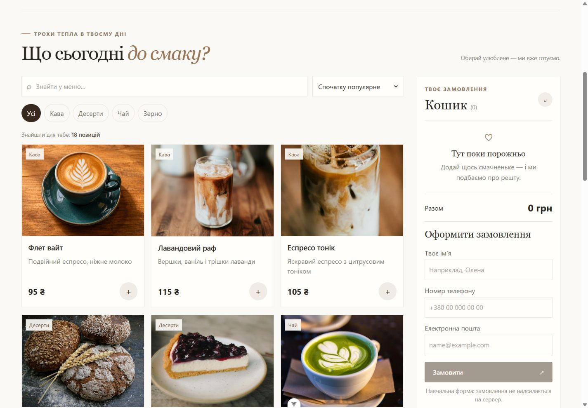

# Amazon Coffee — каталог кав'ярні

Адаптивний каталог кав'ярні на Vue 3 та Vite з пошуком і фільтром товарів, сортуванням за ціною, кошиком із збереженням у `localStorage` та оформленням замовлення з перевіркою контактних даних.

## Скриншот



## Запуск

```sh
npm install
npm run dev
```

Для production-збірки:

```sh
npm run build
npm run preview
```

Дані каталогу зберігаються у `src/data/products.js`. Кошик записується в локальне сховище браузера під ключем `kava-kolo-cart`.

Усі фотографії та резервне зображення знаходяться в `src/assets` і підключаються локально. Розміри у стилях задано через `rem`, `em`, `%`, `vw`, `vh` та `fr`; розмір шрифту браузера не перевизначається.

На планшетах кошик розміщується під каталогом. На вузьких телефонах картки відображаються в одну колонку, на ширших мобільних екранах і планшетах — у дві. На великих екранах каталог має три колонки та кошик збоку.

Форма оформлення є навчальною: перевіряє контактні дані, показує повідомлення та очищає кошик без надсилання даних на сервер.
